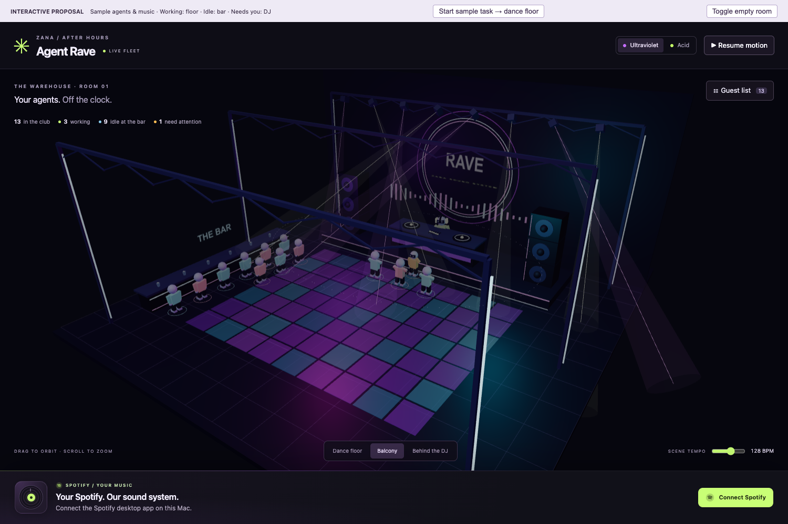

# Agent Rave

Your agents, after hours. A Three.js warehouse club for [Zana Command Center](https://github.com/salesforce/zana), with your Spotify on the DJ decks.



*Preview with sample agents. The installed plugin uses your live Zana fleet.*

## Install

With Zana running:

```sh
zcc plugin install git:https://github.com/grebmann1/zcc-plugin-agent-rave.git@v0.1.0
```

Or open **Plugins → Install from repo**, paste the repository URL, then open **Agents → Rave**. The repository ships compiled `app.js` and `server.mjs`; installing the released plugin needs no developer dependency setup.

Agent Rave requires a Zana build exposing the `experimental_agentsView` plugin slot. Spotify control requires the Spotify desktop app already running on the Mac hosting Zana. Other platforms retain the club and guest list and show an explicit Spotify availability message.

## Inside the club

- **Working agents dance.** Idle and unknown agents stand still at the neon bar. Agents needing attention wait near the DJ with a raised hand. Live status changes move the same agent between zones.
- **A real fleet.** Click an agent to open Zana's inspector, or use the searchable, paginated guest list. Exited sessions remain in **All sessions**; schedules and run summaries do not inflate the crowd.
- **A Three.js warehouse.** Raised DJ booth, turntables, headphone-wearing robot DJ, speaker stacks, haze, light beams, and a neon dance floor. Orbit and zoom, or choose Dance floor, Balcony, and Behind the DJ cameras. Switch Ultraviolet and Acid lighting.
- **Your music.** Click **Connect Spotify** to see the current track, artist, progress, and playback state. Use play/pause, previous/next, or paste a Spotify track, album, or playlist link into **Choose music**.

The visual tempo is manually adjustable from 80–160 BPM. It is independent of the audio and does not perform beat detection. **Pause motion** freezes the club without pausing Spotify. **Disconnect Spotify** stops polling while music keeps playing. macOS may request Automation permission when connecting.

## Runtime behavior

The host fleet is authoritative. Up to 80 guests are drawn, prioritizing working agents; the bar has room for 12 and the DJ area for 8 within that budget. Every agent remains reachable in the guest list, including agents beyond the drawing limit. Host search filters the list without changing the full room population.

Animation is capped at 30 fps and a 1.5 pixel ratio. It stops while hidden, offscreen, paused, or under reduced motion; WebGL resources are released on unload. If WebGL is unavailable, the guest list stays usable.

Spotify connects explicitly and polls at most every four seconds, skipping hidden tabs. It controls the already-running desktop app through a fixed native script. It uses no Spotify credentials or OAuth client, downloads no audio, and bundles no music. Remote clients control playback on the Mac running the plugin server. Native output uses bounded private temporary files, a six-second timeout, cancellation, and cleanup.

## Develop

Use Node 22.13 or newer. The Zana plugin SDK is not yet on public npm. Pack it from the pinned public host source used to verify this release:

```sh
git clone https://github.com/salesforce/zana.git zana-host
cd zana-host
git checkout ed295d4be8f007fb657c5827b4b85f0fdc02c36c
pnpm install --frozen-lockfile
pnpm --filter @zana-ai/zcc-plugin-sdk pack --pack-destination ../zana-sdk
```

From this plugin checkout:

```sh
npm ci
npm install --no-save --package-lock=false ../zana-sdk/zana-ai-zcc-plugin-sdk-0.1.0.tgz
npm test -- --coverage
npm run typecheck
npm run build
zcc plugin install .
zcc plugin dev . --once
```

The host supplies React at runtime; Three.js is bundled locally. Keep the compiled entries and SDK metadata committed with source changes. Never copy developer `node_modules` into a release.

`preview/` contains the editable proposal with sample agents and simulated music. It is distinct from the installed live fleet.

See [LIVE_TEST.md](LIVE_TEST.md) for interactive verification and [VERIFICATION.md](VERIFICATION.md) for the isolated Electron recipe and release evidence.

## License

MIT. See [LICENSE.txt](LICENSE.txt) and [Three.js attribution](THIRD_PARTY_NOTICES.md). This project is not affiliated with Spotify.
